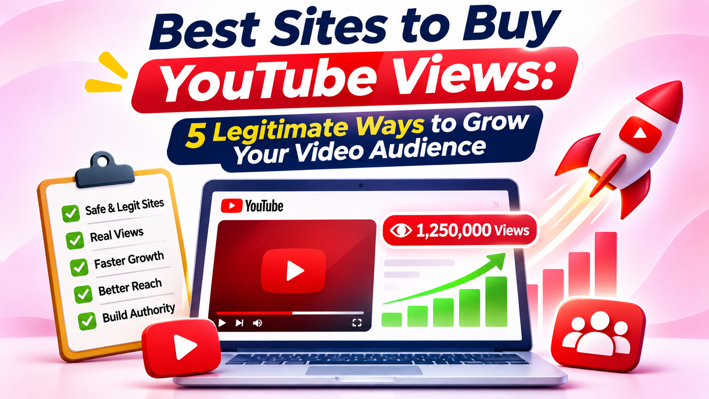

# Best Sites to Buy YouTube Views: 5 Legitimate Ways to Grow Your Video Audience

Getting views on [**YouTube**](https://www.yttags.com/) is one of the biggest challenges for new creators, businesses, musicians, and established channels. Even when a video has useful information, excellent editing, and an attractive thumbnail, reaching the right audience can take time. That is why many creators search for the best sites to buy YouTube views and explore paid promotion options.

However, not every service that promises more views is worth your money. Some providers use artificial traffic, bots, or misleading engagement methods that can put a YouTube channel at risk. A better approach is to invest in legitimate advertising, creator collaborations, and audience-targeted campaigns that help real people discover your videos.

In this guide, we compare five options for promoting YouTube videos and reaching potential viewers. We cover their best uses, features, pricing models, advantages, and limitations so you can choose a suitable method. We will also explain how to avoid fake views and build a stronger YouTube presence over time.

## Comparison Table: Best Sites to Buy YouTube Views

| Platform | Best For | Promotion Method | Pricing |
|---|---|---|---|
| YouTube Promote | Beginners and creators | Official YouTube promotions | Set your own budget |
| Google Ads | Advanced targeting and campaigns | YouTube video advertising | Flexible campaign budget |
| Sprizzy | Managed YouTube promotion | Google Ads campaigns managed by Sprizzy | Starts at $50 per promotion |
| Collabstr | Influencer collaborations | Paid creator partnerships | Free plan; paid plans and creator fees |
| YouTube Creator Partnerships | Eligible creators and brands | Brand and creator collaborations | Negotiated partnership rates |

*Note: These platforms are not all traditional view-selling websites. They are included because they offer legitimate ways to increase video exposure. Paid promotion does not guarantee organic growth, subscribers, or monetization eligibility.*

### 📈 [Explore Websites to Buy YouTube Views →](https://www.yttags.com/best-sites-to-buy-youtube-views/)

## 1. YouTube Promote

**Best For:** Beginners, small channels, and creators who want a straightforward official promotion option.

YouTube Promote is an advertising feature that allows creators to promote their videos directly through YouTube. Instead of purchasing artificial views from an unknown seller, you can use this tool to show your content to potential viewers through YouTube's advertising system.

The process is designed to be accessible, even if you have never managed an advertising campaign. You select a video, choose a campaign goal, define an audience, and set a budget. YouTube then displays the promotion to people who may be interested in your content.

This option is particularly useful for creators who want to introduce a new channel, promote a product, increase awareness of a video, or reach viewers in a particular location. It also keeps the promotion process within the YouTube environment.

Before running a campaign, make sure your video is ready for a new audience. A clear title, attractive thumbnail, strong opening, and useful content can make a significant difference in how viewers respond.

### Key Features

- Official YouTube video promotion tool.
- Campaign setup through YouTube.
- Audience and location targeting options.
- Budget control for promotional campaigns.
- Suitable for videos and eligible Shorts promotions.
- Campaign reporting to help review performance.

### Pricing

YouTube Promote does not have one universal fixed price. You choose a campaign budget based on your goals and available spending. Actual reach and views depend on factors such as audience selection, competition, and campaign settings.

### Pros

- Official promotion option from YouTube.
- Convenient setup for beginners.
- No need to purchase artificial engagement.
- Budget can be controlled.
- Useful for increasing awareness among relevant viewers.

### Cons

- Results depend on campaign budget and audience demand.
- Paid promotion does not guarantee subscribers.
- Advertising views are different from organic recommendations.
- Watch hours and subscribers gained through ad campaigns do not count toward YouTube Partner Program eligibility thresholds.

### Our Review

YouTube Promote is a sensible starting point for creators who want to pay for legitimate exposure without relying on questionable view-selling websites. Its biggest advantage is that it operates within YouTube's own promotional environment.

It is important to understand what the tool can and cannot achieve. A campaign may introduce your video to new viewers, but the quality of the content determines whether those viewers decide to explore your channel. Use Promote as an awareness tool rather than a shortcut to monetization.

### 🏷️ [Extract Tags from Any YouTube Video →](https://www.yttags.com/youtube-tags-extractor/)

## 2. Google Ads

**Best For:** Businesses, professional creators, and marketers who want detailed control over YouTube advertising.

Google Ads is a powerful advertising platform for promoting videos on YouTube and eligible Google video partner placements. It gives advertisers more campaign controls than a basic promotion setup, making it useful for creators and businesses with specific marketing goals.

You can build campaigns around video views, reach, awareness, website traffic, and other objectives. Depending on the campaign type, you can choose audience characteristics, topics, keywords, locations, and other targeting options.

For example, a cooking channel might target people interested in recipes, kitchen equipment, and food-related content. A software company could promote a tutorial to people researching a particular technology. This approach helps put a video in front of viewers who may have a genuine reason to watch it.

Google Ads also provides campaign reporting. Advertisers can review spending and performance, then adjust targeting or creative choices based on the results. This makes it a useful option for people who want to test and improve their promotion strategy over time.

### Key Features

- YouTube video advertising campaigns.
- Multiple campaign objectives and ad formats.
- Audience, topic, keyword, and location targeting.
- Campaign budget and bidding controls.
- Reporting for views, costs, and campaign performance.
- Options for in-stream, in-feed, and Shorts advertising.

### Pricing

Google Ads uses flexible campaign budgets. There is no single fixed price for a YouTube view. Costs vary depending on the audience, campaign objective, competition, bidding strategy, and ad format. You can begin with a budget that fits your marketing plan and adjust it as you learn from the results.

### Pros

- Extensive campaign targeting options.
- Useful for both small and large advertising budgets.
- Detailed performance reporting.
- Suitable for business and creator promotion.
- Offers multiple video advertising formats.

### Cons

- The advertising interface can take time to learn.
- Poor targeting can waste budget.
- Campaign performance requires monitoring.
- Paid views do not automatically translate into loyal subscribers.

### Our Review

Google Ads is one of the strongest choices for creators who want control over their YouTube promotion. It is particularly useful when you have a defined audience and a clear goal, such as introducing a product, promoting a music video, or attracting viewers to an educational channel.

The platform is more hands-on than a simple promotion service, so beginners may need time to understand campaign settings. Nevertheless, its targeting and reporting tools make it a valuable option for a serious, measurable advertising strategy.

### ✨ [Generate SEO-Friendly YouTube Tags →](https://www.yttags.com/youtube-tags-generator/)

## 3. Sprizzy

**Best For:** Creators who want help setting up and managing YouTube video advertising.

Sprizzy is a YouTube promotion service that uses Google Ads to show videos to potential viewers. Rather than selling a package of guaranteed bot views, the service describes its approach as running video advertisements on YouTube.

The platform is designed for creators who want promotional support without managing every part of a Google Ads campaign themselves. Users select a video, provide audience preferences, choose a budget, and submit the campaign for review.

Sprizzy says that targeting can include keywords, countries, languages, and similar channels or videos. Its team helps configure the campaign, while Google's advertising system handles ad delivery.

This can be helpful for musicians, educators, podcasters, and businesses that have already published a video but want to reach a larger relevant audience. As with any advertising service, results depend on the campaign, content, and audience.

Before paying, review the current campaign terms, refund conditions, targeting choices, and estimated delivery. Do not assume that a projected view count represents a guaranteed number of subscribers or customers.

### Key Features

- YouTube video promotion through Google Ads.
- Campaign setup assistance.
- Audience targeting options.
- Budget-based campaign management.
- Campaign reporting.
- No monthly subscription required for its standard pay-as-you-go promotion model.

### Pricing

Sprizzy currently advertises promotions starting at **$50 per campaign**. The final cost and estimated reach depend on the audience and campaign settings. Check the official pricing page before placing an order because pricing and offers may change.

### Pros

- Designed specifically for YouTube video promotion.
- Helps simplify campaign setup.
- Uses Google Ads rather than claiming to deliver bot traffic.
- Pay-as-you-go pricing.
- Offers audience targeting and campaign reports.

### Cons

- The minimum advertised budget may not suit every beginner.
- Results vary by targeting and content quality.
- A campaign cannot guarantee subscribers or long-term engagement.
- Creators have less direct control than when managing their own Google Ads account.

### Our Review

Sprizzy is worth considering if you want to promote a video through YouTube advertising but would prefer assistance with campaign setup. Its approach is more suitable than services that promise instant views without explaining where the traffic comes from.

The main consideration is cost. Start with a budget you can afford to test, examine the reporting, and evaluate whether viewers are relevant to your channel. Avoid increasing your spending simply to chase a larger public view count.

### 🔑 [Discover the Best YouTube Keyword Generators →](https://www.yttags.com/11-best-youtube-keyword-generator-tools/)

## 4. Collabstr

**Best For:** Creators and businesses interested in influencer marketing and audience-based video promotion.

Collabstr is an influencer marketing marketplace where brands can discover and hire creators across platforms, including YouTube. Instead of paying for a specific number of views, businesses can work with creators who already have an audience that matches their target market.

This can be a useful alternative to traditional view-purchasing services. For example, a fitness brand could collaborate with a YouTube creator who regularly publishes workout videos. A technology company could work with a reviewer whose audience is interested in software, gadgets, or tutorials.

A creator partnership may involve a sponsored video, product mention, review, demonstration, or another agreed promotional format. The campaign should clearly explain what the creator will deliver, when it will be published, and how payment will work.

Collabstr provides creator profiles and marketplace features to help brands compare potential partners. Its pricing page also describes subscription plans, hiring fees, and payment protections. Review the current terms carefully before choosing a plan or hiring a creator.

### Key Features

- Creator discovery across multiple social platforms.
- YouTube influencer marketplace.
- Creator profiles and audience information.
- Direct hiring and campaign options.
- Secure payment and escrow features.
- Campaign and performance tracking features on eligible plans.

### Pricing

Collabstr offers a free plan for exploring the marketplace. Its pricing page also lists paid subscriptions, including Pro and Premium plans, as well as hiring fees. Creator rates are separate and depend on the individual creator, deliverables, audience, and campaign requirements. Check the current pricing page for updated fees.

### Pros

- Helps brands reach established niche audiences.
- Offers more than one type of creator collaboration.
- Useful for product promotion and sponsored content.
- Creator profiles help with comparing potential partners.
- Payment and order-management features are available.

### Cons

- Creator fees can vary considerably.
- A collaboration does not guarantee a specific view count.
- Finding the right creator requires research.
- Subscription and platform fees may increase the total campaign cost.

### Our Review

Collabstr is a strong option when the goal is to reach people who already trust a creator in your niche. It is not a traditional website for buying YouTube views, but influencer marketing can create meaningful exposure when the creator and audience are a good match.

Before hiring anyone, review their recent videos, audience relevance, engagement quality, and previous sponsored work. Agree on deliverables in writing and make sure sponsored content is disclosed appropriately.

### #️⃣ [Find and Extract YouTube Hashtags →](https://www.yttags.com/youtube-hashtags-extractor/)

## 5. YouTube Creator Partnerships

**Best For:** Eligible creators and brands looking for structured sponsorship and creator collaboration opportunities.

YouTube Creator Partnerships is YouTube's system for connecting brands with creators for potential brand deals. It is the evolved name for the platform's earlier BrandConnect features and is designed to make creator discovery and partnership management easier.

For eligible creators, the Creator Partnerships tab can appear in the Earn section of YouTube Studio. Creators may be discovered by brands, receive campaign inquiries, create a media kit, and set preferences such as desired rates for long-form videos and Shorts partnerships.

For brands, working with a relevant creator can be a way to introduce a product or service to an audience that already follows content in that category. A well-matched sponsorship can provide context and credibility that a standard advertisement may not deliver.

This option is not a quick way to purchase a set number of views. It is a partnership route based on content, audience fit, and agreed campaign deliverables. Availability also depends on eligibility and supported regions.

### Key Features

- Brand and creator discovery.
- Creator partnership inquiries through YouTube Studio.
- Customizable creator media kits.
- Rate preferences for long-form videos and Shorts.
- Tools for managing brand inquiries.
- Partnership-related video and campaign workflows.

### Pricing

There is no universal public price for a Creator Partnerships deal. Rates are negotiated between the creator and brand and depend on audience size, niche, content format, campaign requirements, and usage rights.

### Pros

- Integrated with YouTube's creator ecosystem.
- Supports brand and creator discovery.
- Helps eligible creators manage partnership inquiries.
- Useful for sponsorship campaigns and product promotion.
- Encourages audience-relevant collaborations.

### Cons

- Not available to every creator.
- Eligibility and regional availability requirements apply.
- Brand deals require negotiation.
- Not designed for instant or guaranteed view delivery.

### Our Review

YouTube Creator Partnerships is a valuable option for eligible creators who want to build relationships with brands instead of relying on artificial engagement. It can be especially useful for channels with a clear niche and a well-defined audience.

It is not a direct substitute for YouTube advertising, and creators should not expect a fixed number of views from a partnership. Its value comes from connecting brands with creators whose content and audiences are relevant to a campaign.

### 📝 [Create Catchy YouTube Video Titles →](https://www.yttags.com/youtube-title-generator/)

## How to Choose the Best Site to Buy YouTube Views

Choosing a YouTube promotion service requires more than comparing prices or advertised view packages. The most important question is whether the service can help your video reach people who may genuinely care about its subject.

Start by identifying your campaign goal. If you want to introduce a new video to a broader audience, YouTube Promote or Google Ads may be suitable. If you want assistance with advertising setup, Sprizzy is another option. If your goal is to reach a niche community through a trusted personality, consider Collabstr or YouTube Creator Partnerships.

Next, investigate how the service delivers exposure. A provider should explain whether it uses advertising, creator collaborations, or another transparent method. Be cautious of sellers who promise thousands of views instantly, guarantee engagement, or refuse to explain their traffic sources.

Finally, look beyond the view count. Review audience retention, relevant engagement, returning viewers, and whether the campaign attracts people who explore more of your content. A smaller number of interested viewers can be more valuable than a large number of unengaged visits.

## Why You Should Avoid Fake YouTube Views

Fake views may appear attractive because they promise quick results at a low price. However, artificial traffic does not create a real audience. It can also distort your analytics and make it harder to understand how your content performs with genuine viewers.

YouTube's Fake Engagement Policy prohibits artificially increasing views, likes, comments, or other metrics through automated systems or deceptive methods. The policy also explains that creators can be held responsible for the actions of third-party promotion providers they hire.

Artificial traffic may be removed or excluded from view counts. Serious or repeated violations can also lead to channel penalties, including removal or termination. This makes cheap bot-view packages a risky choice for anyone building a long-term channel.

A safer strategy is to use official advertising tools, collaborate with relevant creators, and promote videos through communities where the subject is genuinely useful. These methods may take more planning, but they support a healthier audience-development strategy.

You can read the official policy here: https://support.google.com/youtube/answer/3399767

### 💡 [Generate Fresh YouTube Video Ideas →](https://www.yttags.com/youtube-video-ideas-generator/)

## How to Get More Organic YouTube Views After Promotion

Paid promotion can introduce your video to new people, but organic growth depends on giving viewers a reason to stay. Start with the video itself. Make sure the opening quickly communicates what the viewer will learn, see, or experience. Avoid long introductions that delay the main point.

Your title and thumbnail should work together. The title should explain the value of the video, while the thumbnail should make the subject easy to understand at a glance. Avoid misleading claims because attracting the wrong viewers can lead to poor retention.

Use YouTube Analytics to review impressions, click-through rate, average view duration, audience retention, and traffic sources. These measurements can help you identify whether a problem comes from the packaging, the opening, the topic, or the audience being targeted.

Consistency is also important. Publish videos around a recognizable subject so viewers understand what your channel offers. Organize related uploads into playlists, use end screens where appropriate, and give viewers a natural reason to watch another video.

For creators working on video presentation and supporting content, useful resources include a [YouTube tags tool](https://sites.google.com/view/yttags-tool) for exploring metadata ideas and an [AI photo editor resource](https://github.com/best-AI-Photo-Editor) for researching visual editing options. These tools do not guarantee views, but better packaging can help make a video more appealing to its intended audience.

## Important Tools and Resources for YouTube Creators

Growing a channel often involves more than promoting views. Creators may need help with video editing, audience research, community marketing, and checking the authenticity of digital content.

If you are researching promotional support outside YouTube, you can explore this [Reddit marketing agencies resource](https://sites.google.com/view/best-reddit-marketing-agencies/). It is a separate marketing resource rather than a YouTube view provider, so evaluate any agency based on its actual services and campaign methods.

Creators who publish AI-assisted media may also want to learn about detection and verification tools. These resources cover different areas of digital content analysis: [AI detector tools review](https://github.com/10-Best-AI-Detector-Tools-Honest-Review), [AI image detector tools](https://github.com/7-Best-AI-Image-Detector-Tools-in-2027), [AI voice detection tools](https://github.com/6-Top-AI-Voice-Detection-Tools-Reviewed), and [AI video detector tools](https://github.com/8-AI-Video-Detector-Tools-2027-Review).

These resources are not view-purchasing platforms. They may be useful for broader research into content production and authenticity, but always check each project's current documentation, accuracy, and suitability before relying on it.

## Do Paid YouTube Views Help You Get Monetized?

Paid promotion can increase exposure, but it should not be confused with meeting YouTube Partner Program eligibility requirements. YouTube states that watch hours and subscribers gained through ad campaigns do not count toward the relevant YPP eligibility thresholds.

This means that spending money to promote a video is not a shortcut to monetization. A campaign may help introduce your channel to potential viewers, but you still need to build an audience through genuine interest and comply with YouTube's monetization policies.

Creators should focus on publishing original content, developing a recognizable channel identity, and encouraging viewers to return because they find the videos useful or entertaining. Review the current YPP requirements in YouTube Studio or YouTube's official Help Center before planning a monetization strategy.

### 🚀 [Explore the Best YouTube Hashtag Generators →](https://www.yttags.com/top-9-youtube-hashtags-generator/)

## Conclusion

Finding the best sites to buy YouTube views is really about choosing a safe and effective way to promote your videos. Services that promise instant numbers through bots or artificial traffic can put your channel at risk and rarely provide the meaningful audience that creators need.

For official promotion, YouTube Promote and Google Ads are strong options. Sprizzy can help simplify campaign management, while Collabstr and YouTube Creator Partnerships offer routes to audience exposure through creator collaborations and sponsorships.

Before investing, decide what you want to achieve, review the service's delivery method, and set a realistic budget. Track the quality of the viewers you attract instead of focusing only on the public view count. Sustainable YouTube growth comes from combining relevant promotion with valuable content and a genuine connection with your audience.

## FAQs

### 1. What are the best sites to buy YouTube views?

For legitimate video promotion, options include YouTube Promote, Google Ads, and Sprizzy. Collabstr and YouTube Creator Partnerships can help creators and brands reach audiences through collaborations. These options focus on advertising or partnerships rather than artificial view packages.

### 2. Is it safe to buy YouTube views?

It depends on the method. Artificial views generated through bots, automated systems, or deceptive traffic violate YouTube's fake engagement policy. Official advertising and genuine creator collaborations are safer ways to promote content.

### 3. Can I buy 1,000 YouTube views?

You can set a budget for an advertising campaign, but legitimate platforms do not necessarily sell a fixed package of 1,000 views. Actual results depend on targeting, competition, ad format, and viewer behavior. Avoid providers promising guaranteed views from undisclosed sources.

### 4. Do purchased YouTube views count toward monetization?

Views from legitimate advertising can appear in reporting, but YouTube says watch hours and subscribers gained through ad campaigns do not count toward YPP eligibility thresholds. Artificial views may be removed or excluded.

### 5. Is Google Ads good for increasing YouTube views?

Google Ads can be useful for promoting videos to selected audiences. It provides campaign targeting and reporting tools, allowing advertisers to review costs and performance. It does not guarantee subscribers or organic recommendations.

### 6. What is the difference between YouTube Promote and Google Ads?

YouTube Promote offers a simpler promotion experience through YouTube, while Google Ads provides broader campaign controls and more detailed advertising options. The best choice depends on how much control and campaign customization you need.

### 7. How much does Sprizzy cost?

Sprizzy currently advertises promotions starting at $50 per campaign. Actual costs and estimated reach vary according to targeting and campaign settings. Check its official pricing page for the latest details.

### 8. Can influencer marketing increase YouTube views?

Yes, a relevant creator collaboration can introduce your video, product, or channel to an existing audience. However, results depend on the creator's audience, content format, and campaign. No specific number of views should be assumed unless it is clearly included in an agreement.

### 9. How can I identify a fake YouTube view service?

Be cautious of services that promise instant or guaranteed views, offer unusually cheap packages, use unclear traffic sources, or guarantee likes and subscribers together. Look for transparent advertising or creator-collaboration methods instead.

### 10. What is the best long-term way to grow YouTube views?

Publish useful and engaging videos consistently, improve titles and thumbnails, understand audience retention, organize related content, and promote videos to relevant communities. Paid advertising can support discovery, but valuable content is what gives viewers a reason to return.
